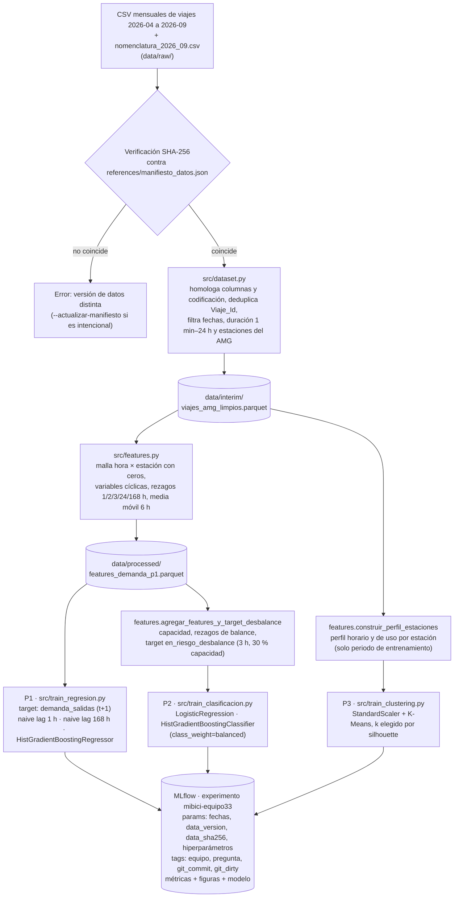

# Diagrama del pipeline — MiBici Equipo 33

**Partición temporal (P1 y P2):** entrenamiento del 2026-04-01 al 2026-08-31, prueba del 2026-09-01 al 2026-09-30.

**Métricas registradas:**

| Pregunta | Métricas |
|---|---|
| P1 | RMSE, MAE, R² (test y train) |
| P2 | ROC-AUC, PR-AUC, Precision, Recall, F1 (clase en riesgo) |
| P3 | Silhouette, Davies-Bouldin, Calinski-Harabasz, inercia, tamaño de clusters |
